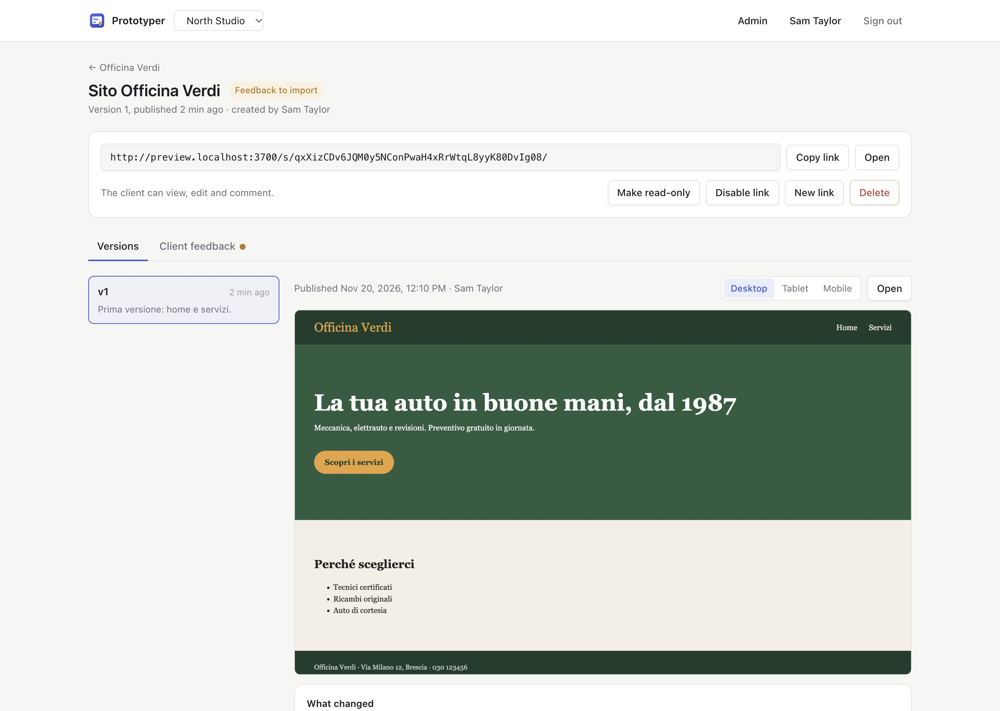
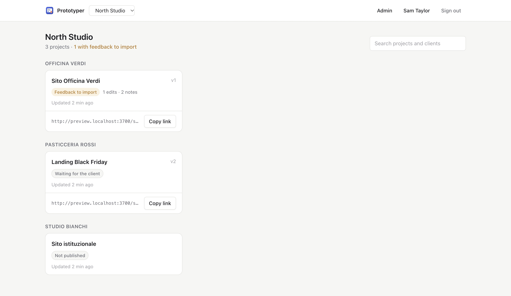
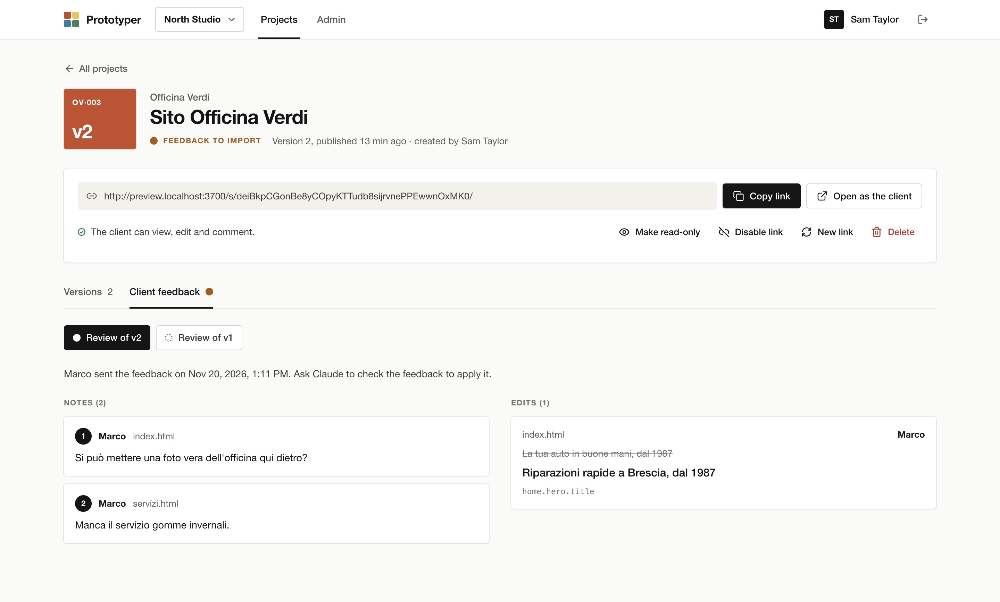

<p align="center"></p>

<h1 align="center">Prototyper</h1>

<p align="center">
Client review links for website prototypes, driven from <strong>Claude Code</strong>. Publish a demo with one sentence, send the link, and the client <strong>edits texts, swaps images and leaves notes</strong> right on the page. Then ask Claude to apply the feedback and publish the next version on the same link.
</p>

<p align="center"></p>

## Why

Agency work often starts with a prototype: a landing page or a few pages to agree on design and copy with the client. Claude Code builds those quickly; the slow part is the back-and-forth: screenshots in emails, "change this sentence", "can we use our photo here", lost notes.

Prototyper gives the client a link where they edit and comment **directly on the prototype**, and gives Claude the tools to read that feedback, apply it and publish the next version. You build however you like (plain HTML, Astro, Vite, Next static export…); Prototyper hosts the review.

## How it works

1. **Build** the prototype with Claude Code in your own project. The Prototyper skill adds `data-pt` attributes to texts and images: that's what makes them editable by the client.
2. **Publish.** *"Create the preview on Prototyper for Studio Rossi."* Claude builds the site and calls `publish`: you get a link like `https://preview.example.com/s/…/`.
3. **The client reviews.** No account needed. They switch between *View*, *Edit* and *Comment*: click a text to rewrite it, click an image to replace it, click anywhere to pin a note, then press *I'm done*.

   

4. **Apply.** *"Check if the client left feedback and apply it."* Claude reads the edits (by key, with the uploaded images) and the notes, changes the sources, publishes the next version with a changelog, and replies to every note.
5. **Same link, next version.** The client sees what's new and the answers to their notes.

   

## The panel

Everything published lives in a web panel: workspaces, clients and projects, every version with its preview (desktop, tablet, mobile), the client's edits and notes, the link (copy, read-only, disable, regenerate).





- **Workspaces** group clients, projects and preview domains. Members see everything in their workspaces; an admin manages people, workspaces and domains.
- **People** join through an invite link. Two-factor authentication (TOTP) is optional for the panel and **required to connect Claude Code**.
- **Preview domains** are added from the panel: point the DNS to the server, add the domain, and Prototyper gets the HTTPS certificate by itself.
- The panel is in English and Italian.

## Install

### 1. The server

Self-hosted: one Docker container (Node and SQLite, HTTPS certificates included). On a server with Docker and the panel's DNS pointing to it:

```sh
mkdir prototyper && cd prototyper
curl -fsSLO https://raw.githubusercontent.com/Aleloca/prototyper/main/deploy/docker/compose.yaml
curl -fsSL https://raw.githubusercontent.com/Aleloca/prototyper/main/deploy/docker/.env.example -o .env
# edit .env: PANEL_HOST and ADMIN_EMAIL
docker compose up -d && docker compose logs prototyper   # the first admin's invite link
```

Already running other sites behind nginx, or prefer no Docker? See **[docs/self-hosting.md](docs/self-hosting.md)**.

### 2. The Claude Code plugin

```sh
claude plugin marketplace add Aleloca/prototyper
claude plugin install prototyper@prototyper
```

It adds the `prototyper` MCP server (Node 20+), the skill that teaches Claude the review workflow, and the `/prototyper:publish` and `/prototyper:feedback` commands. Then, in Claude Code: *"Sign in to Prototyper at prototyper.example.com"*. The browser opens: password, 2FA code, *Authorize*. Done once per computer; you can disconnect it from **Account** in the panel.

MCP tools: `login`, `whoami`, `list_projects`, `link_project`, `lint`, `publish`, `check_feedback`, `reply`. Each project folder gets a small `.prototyper.json` with the project it publishes to: commit it, and teammates publish to the same link.

## The content contract

What the client can edit is marked in the HTML:

```html
<h1 data-pt="home.hero.title">Tax advice for business owners</h1>
<p data-pt="home.hero.lead" data-pt-type="rich">At your side for <b>20 years</b>.</p>

<a data-pt="home.hero.cta" href="contact.html">Book a call</a>
```

Keys are stable across versions, so the client's edits always land in the right place. The `lint` tool checks the rules; the skill ([plugin/skills/prototyper/SKILL.md](plugin/skills/prototyper/SKILL.md)) explains them to Claude.

## Repository

| Path | What |
|---|---|
| [`apps/server`](apps/server) | Fastify server: panel API, MCP API, OAuth login, review links, certificates |
| [`apps/panel`](apps/panel) | The panel (React, Tailwind), served by the server |
| [`packages/overlay`](packages/overlay) | Review toolbar injected into review links |
| [`packages/shared`](packages/shared) | The `data-pt` contract: linter and edit application |
| [`packages/mcp`](packages/mcp) | The MCP server, bundled into the plugin |
| [`plugin`](plugin) | Claude Code plugin: MCP server, skill, commands |
| [`deploy`](deploy) | Docker Compose files, deploy script without Docker, nginx site |
| [`docs/DESIGN.md`](docs/DESIGN.md) | Architecture and design decisions |

## Development

Requires Node 22.5+ and pnpm.

```sh
pnpm install
pnpm test
pnpm typecheck
pnpm build
```

See [CONTRIBUTING.md](CONTRIBUTING.md) and the local setup in [docs/self-hosting.md](docs/self-hosting.md#local-development).

## License

[MIT](LICENSE)
