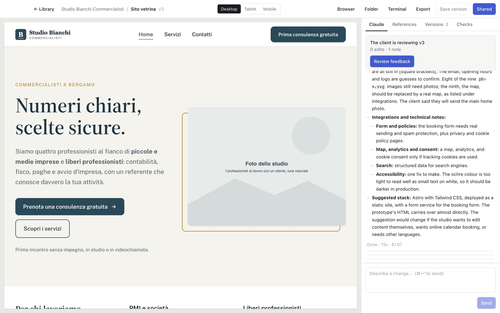
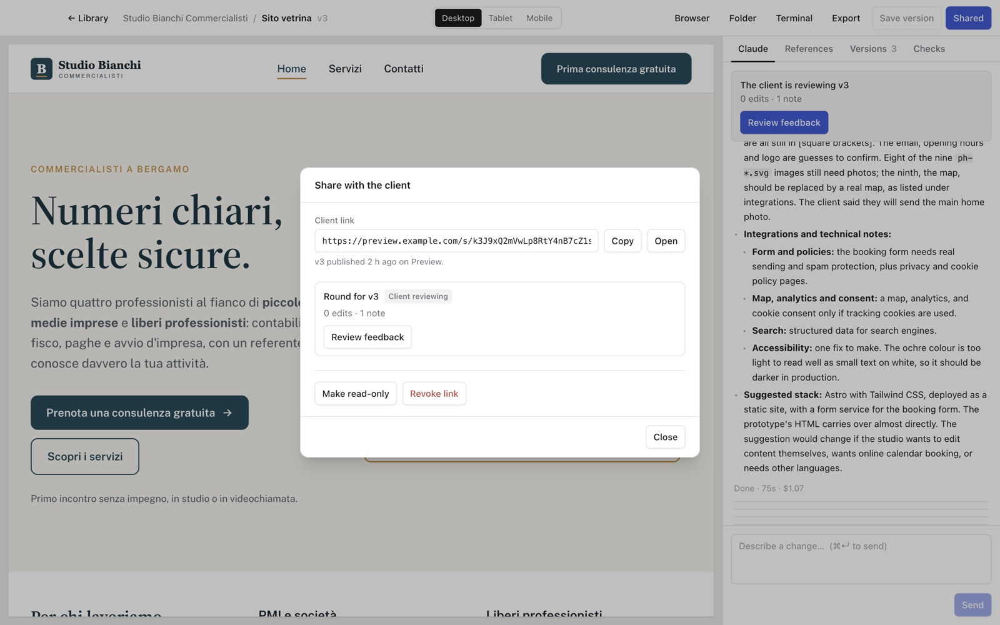
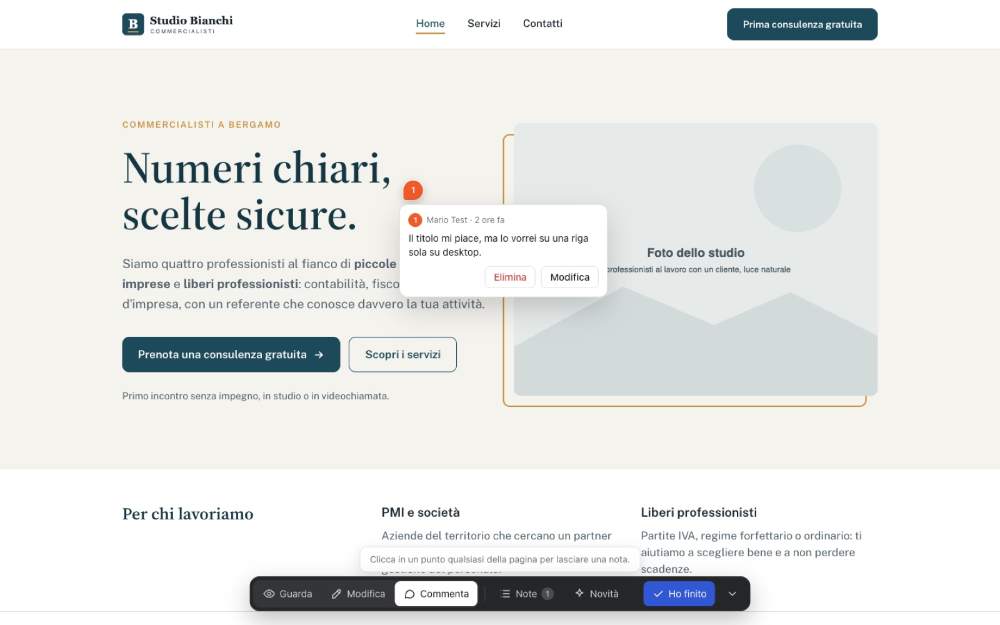
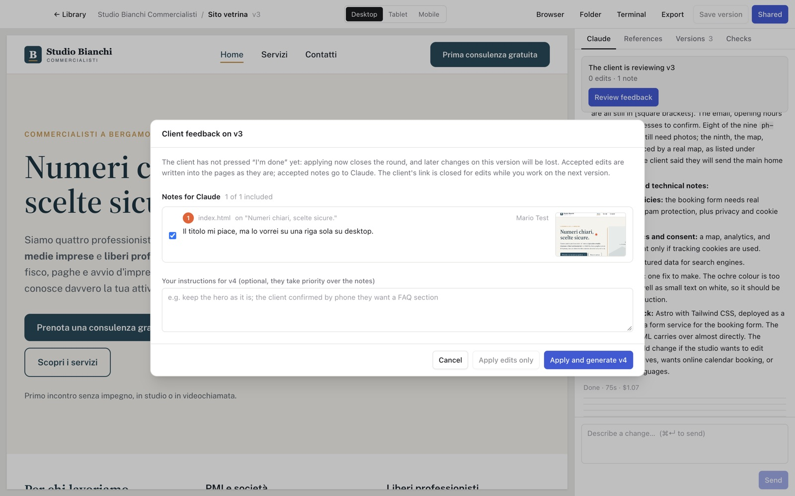
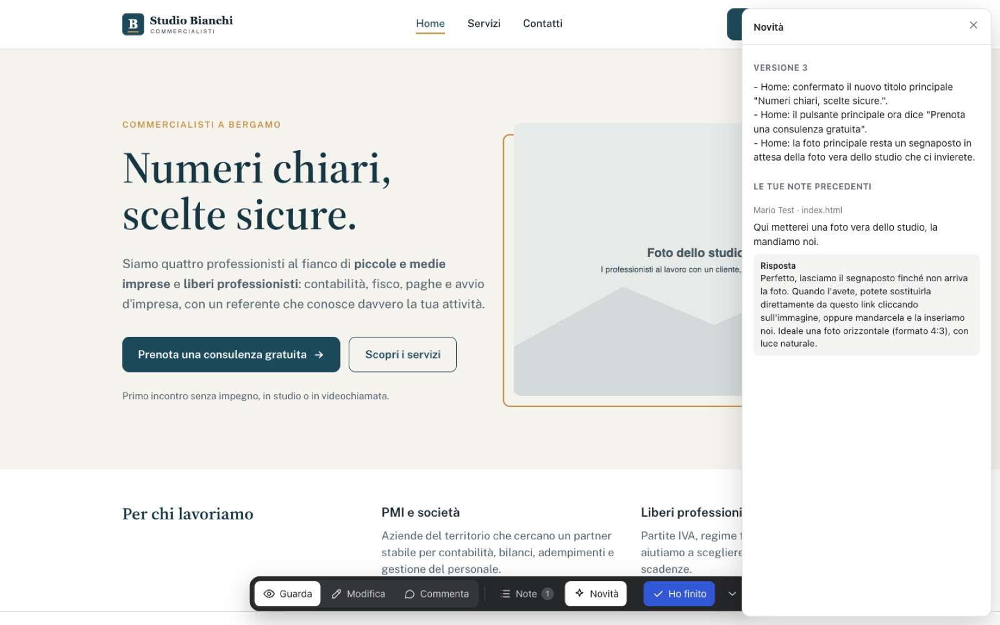

<p align="center"></p>

<h1 align="center">Prototyper</h1>

<p align="center">
Build landing-page and small-site <strong>demos with Claude Code</strong>, share them with clients who <strong>edit texts, swap images and leave notes</strong> right on the page, and iterate version after version until it's approved. Then hand it over to development.
</p>

<p align="center"></p>

## Why

Agency work often starts with a demo: a landing page or a few pages to agree on design and copy with the client. Claude Code builds those quickly, but the back-and-forth is slow: screenshots in emails, "change this sentence", "can we use our photo here", lost notes.

Prototyper keeps every demo in a library, gives the client a link where they edit and comment **directly on the demo**, and turns their feedback into the next version: their edits are applied as they are, their notes go to Claude.

## How it works

1. **Ask.** Tell Claude what you need in the home chat, in your own words: "a landing for Pasticceria Rossi, take the style from their site", "in the Studio Bianchi demo make the hero more minimal". It looks at your library, works out the client and the demo, writes the brief, extracts the brand from the client's website when there is one, and only asks what it really can't guess. Drop screenshots in the chat to use them as references, or an existing page to start from: a folder, a zip, its HTML and CSS files, or just write the folder path.
2. **Generate.** Prototyper drives your local, logged-in [Claude Code](https://claude.com/claude-code) to build a static HTML + Tailwind site. Every text and image gets a stable key, and a linter makes sure of it.
3. **Share.** Publish it to your self-hosted share server and send the link.

   

4. **The client reviews.** No account needed. They switch between *View*, *Edit* and *Comment*: click a text to rewrite it, click an image to replace it, click anywhere to pin a note, then press *I'm done*.

   

5. **Import.** You get a notification. Review each edit and note, accept or reject them. Accepted edits are written into the pages by key, without the model; accepted notes go to Claude together with a screenshot of the commented spot.

   

6. **Next version.** Claude addresses the notes and writes a changelog plus a reply to every note. Publish again on the **same link**: the client sees what's new and the answers to their notes.

   

7. **Export.** When it's approved, export the static site, or a **handoff pack** for developers: the prototype, the approved copy as `content.json` (by page and key), brand tokens and guidelines, the history of decisions with the client, a `HANDOFF.md` written by Claude and a `CLAUDE.md` to start the real project.

## Install

**Requirements:** macOS on Apple Silicon, and [Claude Code](https://claude.com/claude-code) installed and logged in. Prototyper uses your own Claude Code: it stores no API keys.

1. Download `Prototyper-<version>-arm64.dmg` from [Releases](https://github.com/Aleloca/prototyper/releases) and drag Prototyper to Applications. Release builds are signed and notarized by Apple.
2. Open it. On first launch it checks that Claude Code is available; set its path in Settings if it isn't found.
3. To share demos with clients, deploy a share server ([self-hosting guide](docs/self-hosting.md)) and add its domain in **Settings → Share domains**. Everything else works without one.

The interface is available in English and Italian (Settings → Interface language).

## Self-hosting the share server

A single Node process with SQLite (built into Node), deployed behind nginx with pm2. One server can serve several domains, and each demo answers only on the domain it was published to. See [docs/self-hosting.md](docs/self-hosting.md).

## Repository

| Path | What |
|---|---|
| [`apps/desktop`](apps/desktop) | Electron app: library, Claude runner, build and preview, versions, sharing, feedback import, brand, export |
| [`apps/server`](apps/server) | Share server: serves demos to clients and stores their edits, images and notes |
| [`packages/overlay`](packages/overlay) | Review toolbar injected into shared demos |
| [`packages/shared`](packages/shared) | The `data-pt` content contract: linter, edit application, export helpers |
| [`packages/prototype-kit`](packages/prototype-kit) | `CLAUDE.md` templates, prompts and starter files |
| [`docs/DESIGN.md`](docs/DESIGN.md) | Architecture and design decisions |

## Development

Requires Node 22.5+ and pnpm.

```sh
pnpm install
pnpm test
pnpm typecheck
pnpm --filter @prototyper/desktop dev
```

Try the app without touching your real library and settings:

```sh
PROTOTYPER_LIBRARY=/tmp/pt-lib PROTOTYPER_USER_DATA=/tmp/pt-data pnpm --filter @prototyper/desktop dev
```

Build the macOS app: `pnpm --filter @prototyper/desktop dist` (output in `apps/desktop/release/`). See [CONTRIBUTING.md](CONTRIBUTING.md) and [docs/releasing.md](docs/releasing.md).

## License

[MIT](LICENSE)
